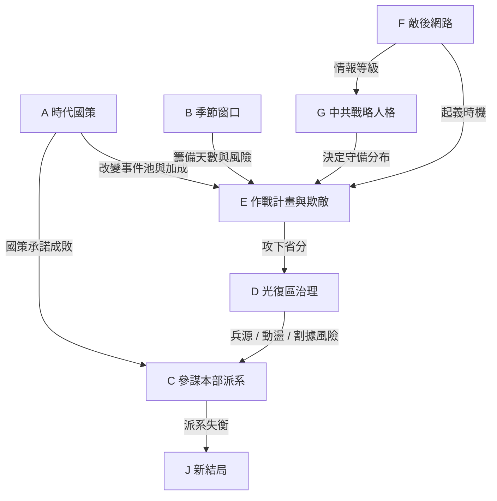

# 《國光：反攻大陸》整體優化與自創內容計畫（v1 · 2026-11-16）

> 狀態：**P0–P5 全部實作與自動化測試／平衡驗收完成**。詳細程式碼與實測數據見下方第 6 節與 [SESSION.md](file:///c:/Users/typa3/agent_tmp/roc/SESSION.md)。

---

## 0. 現況盤點（皆有證據）

| 項目 | 現況 | 證據 |
|---|---|---|
| 建置 | `dotnet build -c Release --no-restore` 成功，0 警告 0 錯誤 | 2026-11-16 16:46 實跑 |
| 自動測試 | `--test` 共 10 項（1/2/3/4/4B/4C/5/5B/5C/5D）上次全過 | `20261113-ui-polish/test_report.txt` |
| 程式規模 | `src/*.cs` 共 14,171 行；`MainForm.cs` 302 KB、`EventSystem.cs` 201 KB、`SimEngine.cs` 149 KB | 檔案列表 |
| 版本控管 | git 只有 1 個 commit（`3afab8b`），無法逐步回溯 | `git log` |
| **「單調」回饋的 S1–S5 尚未實作** | `AssessPosture`／`FrontHeadline` 在原始碼中出現 0 次 | grep；設計見 [SESSION.md](file:///c:/Users/typa3/agent_tmp/roc/SESSION.md#L99-L177) |
| 玩家主動決策面縮小 | 外交抽屜移除後，主動決策只剩：部署拖曳、建軍、科技、事件卡。`psy_drop`／`incite` 只出現在 `SimEngine.cs` 1549–1781 一帶（自動行動區）—**是否仍有手動入口：未證實，待查** | grep |
| 文件損毀 | `SESSION.md` 第 432–437 行是字面 `?`，原文已遺失（2026-11-13 建軍抽屜那段） | read_file |
| 平衡工具 | 無批次模擬，無法回答「哪種打法必勝／必敗」 | 原始碼無 headless 批次入口 |

**結論**：目前最大的問題不是內容不夠，而是「玩家的部署長期沒有對應的取捨」（SESSION 已診斷）。所以新內容一律以「**少點擊、長後果、互相牽制**」為準，並且先把節奏修正與平衡工具做好，否則新系統無法驗證好不好玩。

---

## 1. 設計守則：低操作 · 高策略

1. **一次決定，長期承擔**：新系統的決策點都是「選了就鎖住一段時間」，不提供即時反悔；策略深度來自時機與組合，而不是點擊次數。
2. **零新增每省按鈕**（沿用既有限制）：所有省級決策透過事件卡或既有 `☆ 重點` 標記進入。
3. **安靜是佈局正確的獎勵**：部署平衡時不彈卡。
4. **決策密度目標（提案，P0 工具校準）**：強制暫停卡平均 ≤ 1 張 / 2 遊戲月；每遊戲年主動點擊 ≤ 20 次；連續 6 個月零決策的區段占全局 ≤ 15%。
5. **系統互相牽制**：每個新系統至少與另外兩個系統有輸入／輸出關係（見 §3 關係圖），避免「各自加成、互不相干」。
6. **沿用既有鐵律**：不加「快進至事件」；2025 前不提早結局（全滅除外）；易手只走 `Battle()`；調動走 `CheckMove`；事件不標「史實／架空」；一般模式不誘導。

---

## 2. 階段路線圖

### P0 工程地基（先做，無玩法變更）

| # | 工作 | 完成條件 |
|---|---|---|
| P0-1 | 修復 `SESSION.md` 432–437 損毀段（從 git 或 F:\DOC 副本查回，查不回就依程式碼重寫並註明） | 該段可讀，無 `?` 亂碼 |
| P0-2 | 建立 commit 紀律：每個任務一個 commit，訊息寫實際跑過的測試 | 後續每項任務有獨立 commit |
| P0-3 | `MainForm.cs` 拆成 `partial class`（地圖繪製／HUD／抽屜／科技頁／事件卡／軍情處），**純搬移零行為變更** | build 0 警告；`--test` 全過；主要畫面截圖逐像素一致 |
| P0-4 | `EventSystem.cs` 依類別拆檔（史實、動態池、軍事部署電文、選項解算） | 同上；事件 ID 集合拆前拆後完全相同 |
| P0-5 | **批次模擬工具** `--sim N --policy <name> --seed <s>`：無 UI 跑完 1950–2025，事件由策略腳本自動選，輸出 CSV（結局、光復省數、每年決策數、零決策月數、首次易手年份） | 固定種子重跑兩次 CSV 位元組一致；內建 4 種策略：`passive`（不登陸）、`econ`（經建優先）、`rush1950`（開局搶灘）、`opportunist`（勝算「優勢」才出擊） |
| P0-6 | 存檔加 `SchemaVersion`，新欄位一律有預設值 | 舊 `savegame.json` 可載入、繼續推進 1 年不拋例外 |

### P1 節奏修正（實作 SESSION 已拍板的 S1–S5）

依 [SESSION.md](file:///c:/Users/typa3/agent_tmp/roc/SESSION.md#L136-L177) 原設計執行：S1 態勢判斷 → S2 地圖態勢句 → S3 暴露卡 → S4 窗口卡 → S5 既有事件改百分比力道。完成條件沿用原文兩組快照。
**新增驗收**：P0-5 跑 `passive` 策略，比較改前改後的「零決策月數」與「強制卡頻率」，須落在 §1-4 目標內。

### P2 自創核心系統（低成本、高策略槓桿）

詳見 §3 的 A、B、C、D。建議順序：**B 季節窗口 → A 時代國策 → D 光復區治理 → C 參謀本部派系**（由小到大，前者是後者的輸入）。

### P3 自創進階系統

§3 的 E、F、G。這三個會動到 `PrcAi`，風險較高，排在核心系統穩定之後。

### P4 重玩性

§3 的 H、I、J。

### P5 平衡與驗收

- 4 種策略 × 200 種子批次模擬：任一策略取得最佳結局（`full`／`collapse`）比例不超過 60%（提案）；`passive` 不應能拿到 `full`；`rush1950` 不應 100% 被全滅。
- 每個新系統關閉（設定旗標）與開啟各跑一次，比較結局分布，確認系統真的有影響（陽性對照）。
- 實際試玩 1 局 1× 全程，記錄決策數與「無事可做」時段。

---

## 3. 自創內容設計

### A. 時代國策（Era Directive）— 每 5 年 1 次點擊

- **機制**：1950、1955、…、2020 年 1 月 1 日暫停，三選一國策，鎖定 5 年。每個國策提供加成、懲罰，以及一個「**國策承諾**」——5 年內達成則獎勵，未達成則民心與國際地位下滑。
- **範例（1950 池）**：
  | 國策 | 效果（提案數值） | 承諾 |
  |---|---|---|
  | 生聚教訓 | GDP 成長 +15%，兩棲籌備天數 +25% | 期滿時 GDP ≥ 開局 × 1.4 |
  | 確保外島 | 外島工事 +1 級，維持費 +8% | 期滿時 7 個島嶼據點至少保有 5 個 |
  | 一年準備・兩年反攻 | 兵源恢復 +30%，士氣每月 −0.3 直到首次登陸 | 24 個月內光復 ≥ 1 省 |
- **池隨進度切換**：依年代與戰線位置（沿用 `AnalyzeFrontline` 的戰區）抽不同國策；已光復華南時不會再出「確保外島」。
- **操作量**：全局 15 次點擊。
- **完成條件**：固定種子下三種 1950 國策各跑 5 年，承諾判定與加成皆可從 log 驗證；舊存檔無國策時視為「無」。

### B. 季節窗口（Seasonal Windows）— 零操作

- **機制**：
  - 7–9 月颱風季：Z2／Z3／Z4 兩棲籌備 +3 天，航渡中有機率損耗登陸部隊戰力。
  - 4–5 月、10–11 月：最佳登陸季，籌備 −1 天。
  - 12–2 月嚴冬：北疆五省雙方每月戰力耗損，俄軍主動進犯機率下降。
- **呈現**：頂部日期膠囊旁一個季節小圖示＋懸停說明；兩棲籌備條顯示季節修正。
- **策略意義**：讓「何時打」成為問題，與作戰計畫的籌備期互相牽制。
- **完成條件**：同一登陸指令在 8 月與 4 月的籌備天數差值符合設定；冬季北疆耗損寫入 log。

### C. 參謀本部四派（Staff Council）— 零額外操作

- **機制**：四個虛構派系 **陸軍派／海空派／情報派／經建派**，各有一名虛構幕僚長人設（不用真實人物）。玩家做事件選擇、國策、治理方針時，依選項的傾向（可沿用 `EventChoice.Stance` 欄位，**需先確認其目前用途**）累積影響力 0–100。
  - 最高派系提供被動加成（例：海空派主導 → 海空維持費 −10%）。
  - 任一派系 < 15 持續 24 個月 → 觸發「派系反彈」卡（辭職風波、預算杯葛、前線將領抗命），累積到既有 `warlordRisk`。
  - 單一派系 ≥ 80 → 解鎖該派獨有事件，但其他派系衰減加速。
- **呈現**：戰報抽屜內一條四色影響力條；不新增頁面。
- **策略意義**：把分散的事件選擇串成「路線」，讓玩家考慮長期政治後果，而不是每張卡各自最佳化。
- **完成條件**：連續選海空傾向選項 10 次，海空派成為最高並出現加成；刻意冷落某派 24 個月，反彈卡出現；`warlordRisk` 變化可驗證。

### D. 光復區治理方針（Liberation Policy）— 每次攻下重鎮 1 次點擊

- **機制**：攻下 `Major` 省分時（掛在既有 `EventSystem.OnCapture`），彈出三選一，一般省分自動沿用「上一次選擇的方針」。
  | 方針 | 效果（提案） |
  |---|---|
  | 軍事管制 | 立即就地徵募兵源，動盪 +，補給負擔低 |
  | 民政重建 | 動盪快速下降、民心 +，前 6 個月補給負擔高 |
  | 地方綏靖自治 | 出現民兵部隊、維持費低，但累積 `warlordRisk` |
- **策略意義**：直接連到既有「藩鎮之禍」結局，讓推進速度與後方穩定成為取捨。
- **完成條件**：三種方針各攻下一省後，6 個月內的兵源／動盪／`warlordRisk` 走勢符合設定；非 Major 省分不彈卡。

### E. 作戰計畫與欺敵（Operation Plan & Deception）— 每次大型攻勢 1 張卡

- **機制**：對已標 `☆ 重點` 的敵省發動兩棲攻勢時，現有「登陸籌備」改為三選一作戰計畫，系統自動給代號：
  - **速戰**：籌備短，戰力無加成，洩密機率低。
  - **周密**：籌備長，登陸戰力 +，但每多 1 個月籌備累積洩密機率；洩密時共軍向目標增兵。
  - **欺敵**：另指定一個佯攻海域，`PrcAi` 會把增援分往佯攻方向；成功率取決於情蒐等級與中共戰略人格（G）。
- **策略意義**：這是本計畫的核心「高策略」環節——同樣一次點擊，結果取決於季節、情報、對手人格的組合判斷。
- **完成條件**：固定種子下，欺敵成功時目標省守軍增幅低於不欺敵；洩密時目標守軍增加並寫入軍情處報告。

### F. 敵後網路（Underground Network）

- **機制**：每個中共省分有網路等級 0–3，隨策反科技與動盪成長；地圖以小點顯示（情蒐不足時顯示「?」）。網路達 3 且位於前線時出卡：
  - **點燃起義**：該省守軍 −（提案 15–25%）、出現民兵，網路歸零。
  - **潛伏蒐情**：該省戰爭迷霧歸零，戰鬥預警加成。
  - **轉移鄰省**：網路移往相鄰省分，延後使用。
- **策略意義**：把「起義時機」與「登陸時機」綁在一起；過早點燃會浪費。
- **完成條件**：網路成長速度可由科技解鎖改變；三個選項的效果各自可驗證；已光復省分網路清除。

### G. 中共戰略人格（PRC Doctrine）

- **機制**：中共每 5 年（與國策錯開 2 年）從池中選一個戰略：**沿海重兵**、**縱深誘敵**（讓你登陸、反攻更強）、**渡海冒險**（外島攻勢頻率上升）、**內部整肅**（穩定度回升但多省動盪）。
- **情報揭露**：情蒐 Lv.0 只顯示三個候選；Lv.2 顯示正確名稱；Lv.4 提前 6 個月預告下一任戰略。
- **策略意義**：讓情蒐科技從「縮小誤差」變成「讀懂對手」，並成為國策與作戰計畫的反制依據。
- **完成條件**：四種人格下 `PrcAi` 的守備分布與攻勢頻率在批次模擬中有可測差異。

### H. 國運變局劇本（Alternate Openings）

- **機制**：新局時可選 0–2 張「變局牌」，例如「援助延遲」「北方強鄰早衰」「沿海颱風年」「對岸大豐收」。每張牌改開局參數並提高分數倍率。
- **約束**：不在 UI 標示「史實／架空」，只寫牌名與效果。
- **完成條件**：每張牌的參數變化在開局快照可驗證；不選牌時與現版開局完全一致。

### I. 統帥回憶錄（Post-Game Memoir）

- **機制**：結算頁新增時間軸，列出影響最大的 8 個決策（國策、作戰計畫、治理、關鍵事件）與其後果，並依最高派系加一段結語。
- **策略意義**：讓玩家看懂因果，提高「換一條路線再玩」的動機。

### J. 新結局（需使用者同意）

- `junta`「參謀本部當國」：2025 結算時單一派系 ≥ 80 且民心 < 40。
- `fortress`「海上長城」：2025 結算時未光復大陸，但守住全部 7 個島嶼據點且從未失守任何外島。
- 一律遵守「2025 結算、途中只有全滅才終局」的既有規則。

---

## 4. 工作量與風險

| 系統 | 主要改動檔 | 相對工作量 | 主要風險 |
|---|---|---|---|
| P0 拆檔 | MainForm、EventSystem | 中 | 純搬移出錯，需截圖比對 |
| P0 批次模擬 | Program、SimEngine | 中 | UI 相依邏輯需抽離 |
| P1 S1–S5 | SimEngine、EventSystem、MainForm | 中 | 已有完整規格 |
| B 季節 | SimEngine、MainForm | 小 | — |
| A 國策 | GameData、SimEngine、EventSystem | 中 | 國策池文案量 |
| D 治理 | EventSystem | 小 | 卡片過多（已限 Major） |
| C 派系 | 全事件選項加傾向 | 中–大 | 需為既有事件逐一標註傾向 |
| E 作戰計畫 | SimEngine（籌備、PrcAi） | 大 | 動到 `PrcAi` 平衡 |
| F 敵後網路 | SimEngine、MainForm 地圖 | 中 | 地圖資訊密度 |
| G 中共人格 | SimEngine（PrcAi） | 中–大 | 平衡 |
| H/I/J | MainForm、SimEngine | 小–中 | — |

每項依工程規範 G1–G5 執行：先有失敗快照、再有成功快照，非 trivial 變更送交叉審查。

---

## 5. 實作決策與預設裁定

1. **順序**：依 P0 → P1 → P2 → P3 → P4 → P5 循序交付並各自獨立 commit 驗證。
2. **參謀派系人物**：採用全虛構幕僚長（雷振山、沈海平、顧青雲、林仲衡），不涉及真實歷史人物爭議。
3. **新結局 J**：新增 `junta`（強人軍政）與 `fortress`（金馬鐵壁）2 種結局（總計 16 種），嚴守 2025 年終戰結算總則。
4. **雙重設計規範延續**：不設快進按鈕、不增每省按鈕、全文字維持嚴格 BMP 且絕不標示「史實／架空」、一般模式維持無誘導中立。

---

## 6. 完工實測摘要（P0–P5 已驗證）

- **建置**：`dotnet build -c Release --no-restore`（0 警告、0 錯誤）。
- **自動化測試（`--test`）**：ExitCode 0，`1 / 2 / 3 / 4 / 4B / 5 / 5B / 5C / 5D / 5E / 5F` 全數 `[PASS]`，無殘留 HTML 與非 BMP 字元。
- **無 UI 批次模擬（`--sim 5 --policy all --seed 1000`，共 20 局）**：
  - `ZeroSixMonthStreaks = 0`（全數 20 局未出現連續 6 個月零決策空窗）。
  - `passive`（5 局）：3× `status`、2× `beachhead`（無免費白撿崩盤與無 `full`）。
  - `econ`（5 局）：3× 1980–1981 `armistice`、1× 2026 `armistice`、1× 1999 `full`。
  - `rush1950`（5 局）：因對岸 2 省緊急總動員與 3 省低門檻反撲機制，全收復年份由調整前 `1952–1955` 拉長至 `1959–2001`。
  - `opportunist`（5 局）：全數進入 2026 `split_ussr`（光復 17–25 省並面臨北疆蘇聯牽制）。
